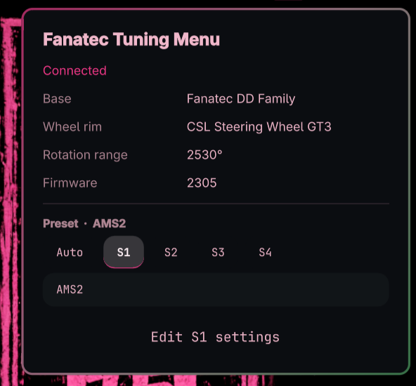
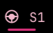
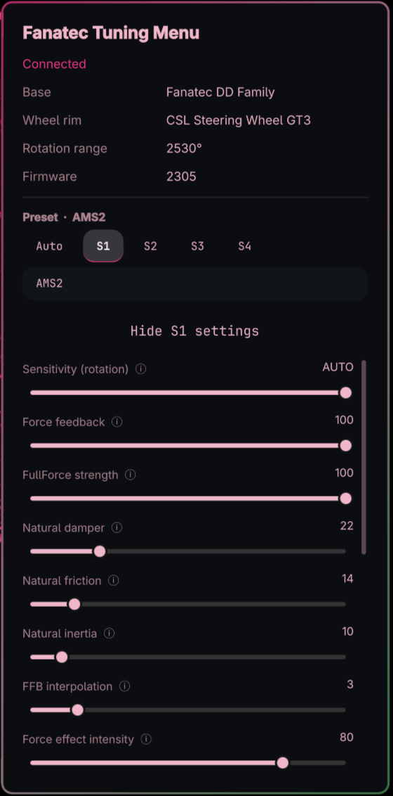

# Omarchy Fanatec Tuning Menu

A bar widget for [Omarchy](https://omarchy.org) that shows the state of a
Fanatec wheelbase and lets you change its tuning menu from the desktop, so you
don't have to dig through the wheel's own display.

It talks to the wheel through the
[`hid-fanatecff`](https://github.com/gotzl/hid-fanatecff) kernel driver
(`fanatec-ff`), which exposes the base and its tuning menu as sysfs files.
The widget only reads and writes those files. It needs no extra daemon.

> Unofficial. Not affiliated with or endorsed by Fanatec / Endor AG. Changing
> tuning values sends commands to your hardware, so use it at your own risk.



The bar shows the active preset next to the icon, and **Edit S1 settings** opens
the tuning-menu list:

| Bar icon | Settings list |
|----------|---------------|
|  |  |

## What it does

- **Bar icon** with the active preset next to it (`A`, `S1` … `S4`). The
  tooltip shows the base, the attached wheel rim and the preset.
- **Panel** with the wheelbase model, rim, rotation range and firmware.
- **Preset buttons** (Auto, S1–S4) to switch the active tuning preset, with an
  optional **nickname** per preset (S1–S4) shown in the panel and tooltips.
  The bar label always stays `A` / `S1` … `S4`.
- **Edit settings** list with a slider or switch for each tuning-menu
  parameter your base exposes, with help text on each (click the label).
  Right-click a slider to reset it to Fanatec's default.
- Wheel-mouse scrolling over the list scrolls the list; it never changes a
  slider by accident.

The parameters follow Fanatec's own
[tuning menu documentation](https://help.fanatec.com/hc/en-us/articles/43901256649233):
SEN, FF, FUL, NDP, NFR, NIN, INT, FEI, FOR / SPR / DPR, BLI, SHO, ACP, brF, plus
force-feedback scaling and the standard / advanced mode switch. Which of them
appear depends on your base, because the driver only creates the files the
base supports.

## Requirements

- Omarchy with the shell (`omarchy-shell`) that supports bar-widget plugins.
- The `hid-fanatecff` driver, loaded, and a connected Fanatec wheelbase.
- Your user in the `games` group, so the widget can **write** (reading works
  without it).

## Setup

### 1. Install the `hid-fanatecff` driver

The driver is in the AUR as `hid-fanatecff-dkms`. Install it with Omarchy's
package tools:

```bash
omarchy pkg aur add hid-fanatecff-dkms
```

This installs it only if it's missing, and reports an error if it didn't land.
Prefer to browse? `omarchy pkg aur install` opens a fuzzy-finder; search for
`hid-fanatecff-dkms` and pick it.

The package builds the `hid_fanatec` kernel module with DKMS and installs a
udev rule (`/usr/lib/udev/rules.d/99-fanatec.rules`). Upstream project and
supported-device list: <https://github.com/gotzl/hid-fanatecff>.

Reboot (or replug the base) once it's installed, then check that the driver
loaded and sees your base:

```bash
omarchy pkg present hid-fanatecff-dkms && echo "package installed"
lsmod | grep hid_fanatec                        # the module is loaded
ls /sys/class/ftec_tuning/                      # one entry per tuning-capable base
cat /sys/bus/hid/drivers/fanatec/*/wheel_id     # id of the attached rim
```

DKMS rebuilds the module for new kernels as part of `omarchy update`. If the
module is missing after a kernel update, reinstall the package to force a
rebuild, then reboot:

```bash
omarchy pkg drop hid-fanatecff-dkms && omarchy pkg aur add hid-fanatecff-dkms
```

### 2. Add yourself to the `games` group

The driver's udev rule makes the tuning files writable by the **`games`**
group, not by regular users. Without it the widget is read-only and shows a
note saying so.

```bash
sudo usermod -aG games "$USER"
```

Then **reboot**. A plain log-out is often not enough: the long-running
`systemd --user` manager that your desktop session inherits its groups from
can survive a log-out and keeps the old group list.

Check that it took effect:

```bash
id | grep -o games                                  # prints "games"
[ -w /sys/class/ftec_tuning/*/SLOT ] && echo writable
```

If `id` doesn't list `games`, the session hasn't picked the group up yet.

### 3. Install the plugin

```bash
omarchy plugin add https://github.com/DGBooth/omarchy-fanatec-tuning-menu.git
omarchy plugin enable io.github.dgbooth.fanatec-tuning-menu
```

Plugins land disabled so you can read the code first. This one runs
unsandboxed inside `omarchy-shell`, like every Omarchy plugin. The icon
appears at the right end of the bar; move it with
`omarchy bar move io.github.dgbooth.fanatec-tuning-menu --before omarchy.clock`
or any other placement.

### Update

```bash
omarchy plugin update                                          # every git-installed plugin
omarchy plugin update io.github.dgbooth.fanatec-tuning-menu    # just this one
```

### Uninstall

```bash
omarchy plugin remove io.github.dgbooth.fanatec-tuning-menu
```

It asks you to confirm (add `--yes` to skip the prompt), turns the plugin off
and deletes its folder. Your wheelbase settings are untouched, since they live
on the wheel.

Removing does not edit `~/.config/omarchy/shell.json`, so the widget's entry in
the bar layout stays behind, along with any nicknames and options. For a clean
removal, open `shell.json` and delete the object with
`"id": "io.github.dgbooth.fanatec-tuning-menu"` from its bar section. Leave it
in place if you plan to reinstall, and your nicknames will come back.

The `hid-fanatecff` driver and your `games` group membership are separate from
the plugin and aren't changed by any of this.

## Using it

- Click the icon to open the panel. Right-click the icon to refresh now.
- Pick a preset with the buttons. The wheel's display and every value in the
  list update to that preset a moment later.
- Click **Edit S2 settings** (it names the active preset) to open the list.
  Drag a slider and release to write it. Click a label to read what the
  setting does and its default.
- Type in the nickname box to name the active preset (S1–S4). Nicknames are
  stored in the plugin's entry in `~/.config/omarchy/shell.json` as `nickS1` …
  `nickS4`; they are not stored on the wheel.

### What it changes

Nothing is written until you act on a control:

- **On the wheelbase:** moving a slider or switch, choosing a preset, resetting
  a slider (right-click) or toggling advanced mode sends that one value to the
  wheelbase, which stores it as part of its tuning menu. The plugin never
  changes a value on its own, and never on install or enable.
- **In `~/.config/omarchy/shell.json`:** only this widget's own entry, and only
  when you edit a nickname or run `omarchy bar set` yourself. Other entries and
  settings are left as they are.
- **Nowhere else:** no other files, and no network access.

### Presets

The driver passes a raw slot number 1–5, and the wheel displays it shifted by
one:

| Button | Wheel shows | Notes                                             |
|--------|-------------|---------------------------------------------------|
| Auto   | A SET       | Auto Setup; games may adjust it                   |
| S1     | SET 1       | Custom preset                                     |
| S2–S4  | SET 2–SET 4 | Custom presets                                    |

The driver only accepts slots 1–5, so a sixth preset (SET 5) can only be
selected from the wheel itself.

## Customising

### Widget options

Options live on the widget's own entry in `~/.config/omarchy/shell.json`,
inside the bar section it sits in (usually `bar.layout.right`):

```json
{
  "id": "io.github.dgbooth.fanatec-tuning-menu",
  "pollingInterval": 5,
  "barShowProfile": false,
  "nickS1": "AMS2"
}
```

| Key              | Type    | Default | What it does                                                        |
|------------------|---------|---------|---------------------------------------------------------------------|
| `pollingInterval`| integer | `10`    | Seconds between background re-reads of the wheel (2–300). `0` turns background polling off; the panel still refreshes when opened and on right-click. |
| `barShowProfile` | boolean | `true`  | Show the active preset (`A`, `S1` … `S4`) next to the bar icon. It is always hidden on a vertical bar. |
| `nickS1` … `nickS4` | string | none | Nickname for each custom preset, up to 24 characters. Easiest set from the panel's nickname box. Auto has no nickname. |

Keys you haven't set use their default, so a fresh install has none of them.
The shell hot-reloads `shell.json` on save, so edits (by hand, through
`omarchy bar set` below, or from the panel's nickname box) apply straight away.

### From the command line

`omarchy bar set` writes an option for you. Pass `--json` for numbers and
booleans, otherwise the value is stored as text and a setting like
`barShowProfile` won't be read as a boolean:

```bash
ID=io.github.dgbooth.fanatec-tuning-menu

omarchy bar set $ID pollingInterval 5 --json      # poll every 5 s
omarchy bar set $ID barShowProfile false --json   # hide the preset label
omarchy bar set $ID nickS2 "Spa wet"              # nickname for S2 (plain text)

omarchy bar get $ID pollingInterval               # prints the value, or exits 1 if unset
```

`omarchy bar get` only returns options you've set explicitly. For one you
haven't touched it prints nothing and exits with status 1, which means the
default applies. To go back to the default, delete the key from the widget's
entry in `shell.json`.

### Where it sits on the bar

```bash
omarchy bar move $ID --section right --index 0       # first in the right section
omarchy bar move $ID --after omarchy.clock           # or next to any other widget
```

The sections are `left`, `centerBegin`, `center`, `centerEnd`, `tray` and
`right`. The plugin's default is `right`.

### Changing what the panel shows

The panel's contents are data in `Model.js`, so most tweaks don't touch the
QML. After editing a file, run `omarchy-restart-shell` to load the change.

- **Settings list**: `tuningDefs` holds each slider's label, range, step,
  default and help text. Reorder it to reorder the list, or remove an entry to
  hide a setting you never use. Entries only appear if the driver exposes
  that setting for your base, so you never need to filter by model.
- **Preset buttons**: `slotOptions` has the button labels and tooltips.
- **Names**: `baseNames` (USB product id → base name) and `wheelNames`
  (rim id → rim name). Use these to name a base or rim the plugin shows as
  unknown.
- **Slider limits**: the minimums and maximums follow Fanatec's documented
  ranges for the DD family. If you raise one, remember the wheel and driver
  still enforce their own limits and will reject values outside them.

The plugin folder is a git checkout, so `omarchy plugin update` can conflict
with local edits. If you want your changes to last, fork the repo and
`omarchy plugin add` your fork instead.

## How it works

A small shell script (`status.sh`) reads `/sys/bus/hid/drivers/fanatec/*/`
(`range`, `wheel_id`, `fw_version`) and `/sys/class/ftec_tuning/*/` (every
tuning value) and prints `key=value` lines. `Panel.qml` parses them with
`Model.js` and draws the bar widget and panel. Writes go to
`/sys/class/ftec_tuning/<device>/<NAME>`, restricted to a fixed list of
parameter names, and the panel re-reads the wheel shortly after to show what
the wheel actually accepted.

## Development

The plugin folder is a plain git checkout. Saving a file under
`~/.config/omarchy/plugins/` reloads the plugin; if a change doesn't apply, run
`omarchy-shell shell rescanPlugins` or `omarchy-restart-shell`.

```bash
omarchy plugin validate .   # manifest check, same one the store runs
node --test tests/          # Model.js unit tests, no dependencies
```

Text that doesn't come from the plugin (nicknames, names read from the
device) is stripped of markup characters before it reaches Omarchy's shared
tooltips, and every `Text` in the panel is `PlainText`.

## Security notes

**What the plugin does.** It runs no privileged commands: no `sudo`, `pkexec`,
package manager or service control. The `sudo` and package commands in this
README are for you to run yourself during setup. At runtime it reads a few
values from sysfs, writes to `/sys/class/ftec_tuning/*` only when you act on a
control (see [What it changes](#what-it-changes)), and stores its options in its
own entry in `shell.json`. It makes no network requests. Like every Omarchy
plugin it runs unsandboxed inside `omarchy-shell`, so read the code if you
want to be sure.

**The driver's udev rule.** The `hid-fanatecff-dkms` package (0.2.3) installs
`/usr/lib/udev/rules.d/99-fanatec.rules`, which contains

```
SUBSYSTEMS=="usb", ATTRS{idVendor}=="0eb7", MODE="0666"
```

That makes the matching USB device nodes writable by every local account, not
just members of `games`. While a wheel is connected, any user on the machine could
reset it or detach its driver, which would disrupt the controller whether or
not this plugin is installed. On a single-user desktop the practical risk is
low; on a shared machine it is worth knowing about. The rule belongs to the
upstream driver ([gotzl/hid-fanatecff](https://github.com/gotzl/hid-fanatecff)),
and the rule file itself carries a comment that it should be narrowed down. This
plugin doesn't install or change it. A file with the same name in
`/etc/udev/rules.d/` takes precedence over the packaged one, so you can adjust it
locally; if you do, check afterwards that your wheel and your games still work.

The plugin only needs the `games` group for the tuning files. It doesn't depend
on the `0666` rule.

## Limitations

- Developed and tested on one setup: a CSL DD-family base (`0EB7:0020`) with a
  CSL Steering Wheel GT3. On that setup, values changed in the panel reach
  the wheel, and values changed on the wheel itself show up in the panel.
  Other bases and rims should work wherever the driver creates the tuning
  files, but are untested.
- The CSL DD, GT DD Pro and ClubSport DD share one USB id, so the base is
  shown as "Fanatec DD Family". Other bases are named from the driver's
  product ids.
- Wheel rims are recognised by id. Unknown ones show as `Unknown rim (0xNN)`.
  To add one, read its id from `/sys/bus/hid/drivers/fanatec/*/wheel_id` and
  add `"0xNN": "Name"` to `wheelNames` in `Model.js` (pull requests welcome).
- The widget polls; changes made on the wheel itself appear at the next
  refresh.
- Value ranges come from the driver and Fanatec's article for the DD family;
  older bases may have different limits.

## License

MIT, see [LICENSE](LICENSE).
